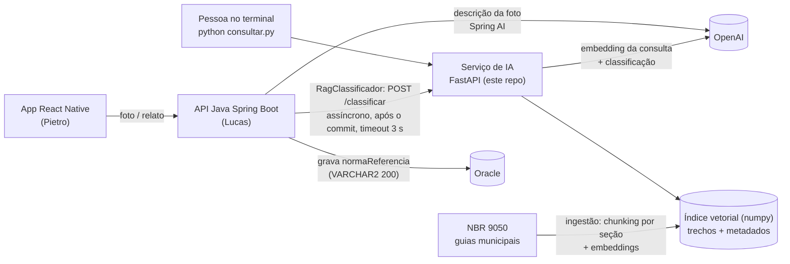
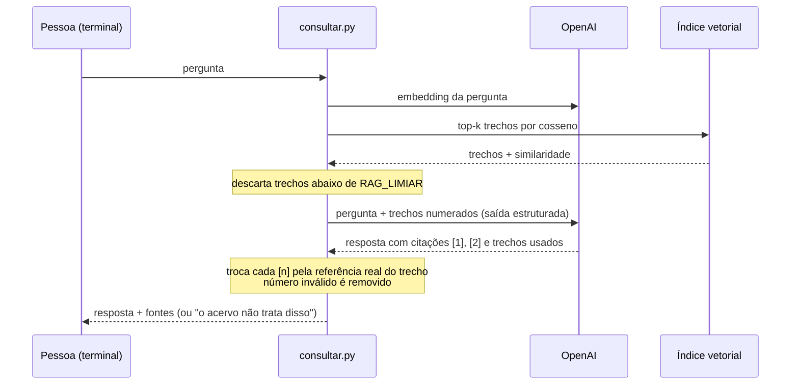
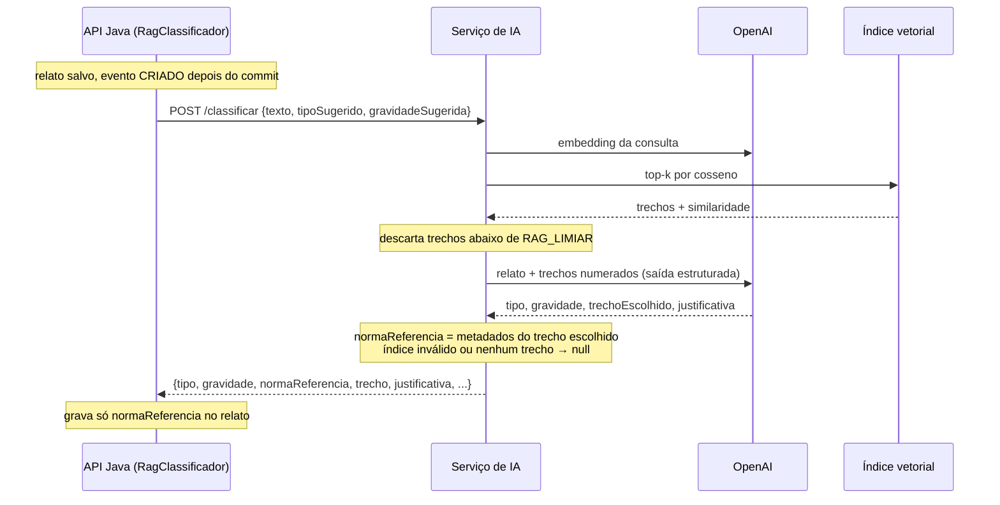

# Vê AI · Serviço de IA

**IA de consulta sobre acessibilidade para pessoas com deficiência visual**, parte do projeto **Vê AI**. Responde perguntas sobre o que as normas e leis exigem (calçadas, piso tátil, rampas, travessias, estabelecimentos) e classifica relatos de barreiras, sempre citando a seção da norma ou o artigo da lei de onde tirou a informação. Funciona sozinha, pelo terminal; a integração com a API Java do projeto é opcional.

Disciplina: **Disruptive Architectures: IoT, IoB & Generative IA** · FIAP 2TDS · Global Solution 2026/2

## Integrantes

| RM | Nome 
|---|---|---
| 561413 | Lucas Grillo Alcântara 
| 562027 | Lucca Ramos Mussumecci 
| 561469 | Pietro Ferreira Gomes Abrahamian 
| 561792 | Pedro Peres Benitez   

## Funcionalidade de IA

O acervo de consulta reúne a ABNT NBR 9050:2020 (acessibilidade em edificações e espaço urbano), a ABNT NBR 16537:2024 (sinalização tátil no piso) e as leis de acessibilidade (Lei 13.146/2015, Lei 10.098/2000 e Decreto 5.296/2004). Tudo funciona pelo terminal. A IA generativa é a da OpenAI (ChatGPT), e o aprofundamento é **RAG**: o modelo só responde com os trechos recuperados desse acervo.

1. **Consulta (função principal, `python consultar.py`).** A pessoa pergunta, por exemplo, "Qual a largura mínima da faixa livre?" ou "Tenho uma loja com um degrau na entrada; o que preciso adequar para clientes cegos?". O serviço busca os trechos mais relevantes, o modelo responde só com eles e cita cada informação pelo número do trecho, e o sistema troca esse número pela referência real (`ABNT NBR 9050:2020 6.12.3`). Se o acervo não trata do assunto, a resposta diz isso em vez de inventar. Público: gestores de ONGs e CRAS, técnicos da prefeitura, donos de estabelecimentos e as próprias pessoas com deficiência visual.
2. **Classificação de relato (`python -m app.classificar` ou `POST /classificar`).** Recebe a descrição de uma barreira ("o orelhão está na calçada sem nada no piso para avisar") e devolve tipo, gravidade, a norma descumprida e uma justificativa para o encaminhamento. É o que a API Java do Vê AI chama quando um relato é criado (classe `RagClassificador`), mas também funciona sozinha.
3. **Descrição de foto (`POST /descrever`, complementar).** JSON estruturado com perigos, resumo, objetos, texto lido e barreira, com regras de segurança aplicadas em código (perigos primeiro, nunca afirmar "caminho livre", aviso para foto escura). No produto, quem descreve as fotos é a API Java.

Nas três, nenhuma referência é escrita pelo modelo: ela sempre sai dos metadados do trecho recuperado.

## Arquitetura



Fluxo da consulta:



Fluxo da classificação de relato (usado pela API Java):



**Integração sem dependência.** O `RagClassificador` só é ativado quando `VEAI_RAG_URL` está preenchida na API Java. Ele roda de forma assíncrona depois do commit, com timeout de 3 s. Se este serviço estiver fora do ar, demorar ou devolver erro, o relato continua válido com `normaReferencia = null`. O relato nunca depende da IA para existir, e a classificação do RAG não altera o tipo nem a gravidade escolhidos pelo cidadão.

**Contrato com a API Java.** Os valores de tipo e gravidade em `app/taxonomia.yaml` são os mesmos dos enums `TipoRelato` e `Gravidade` da API Java e das constraints `ck_relato_tipo` e `ck_relato_gravidade` do Oracle. Se um deles mudar, os três precisam mudar juntos. O teste `test_contrato_do_rag_classificador_java` envia exatamente o JSON do record `ClassificarRequest` da API Java e confere se a resposta tem os campos e valores que o record `ClassificarResposta` espera.

Para ligar a integração, na API Java:

```bash
VEAI_RAG_URL=http://localhost:8000   # ou a URL pública deste serviço
```

## Dados e preparação

| Fonte | Versão | Trechos | Acesso | No GitHub |
|---|---|---|---|---|
| ABNT NBR 9050 (acessibilidade em edificações e espaço urbano) | 2020, 4ª edição | 549 | Publicada pela Prefeitura de São Paulo em drive.prefeitura.sp.gov.br/cidade/secretarias/upload/NBR9050_20.pdf | Não (direitos da ABNT) |
| ABNT NBR 16537 (sinalização tátil no piso) | 2024, 2ª edição | 110 | ABNT (abntcatalogo.com.br) | Não (direitos da ABNT) |
| Lei 13.146/2015, Lei 10.098/2000, Decreto 5.296/2004 | texto vigente | por artigo | planalto.gov.br, baixadas por `python -m app.rag.baixar_leis` | Sim |

Preparação (feita sozinha pelo `consultar.py` quando os documentos mudam; detalhes em `data/fontes/README.md`):

1. **Extração:** texto dos PDFs com pdfplumber; leis do HTML do Planalto, sem os trechos revogados.
2. **Limpeza:** saem sumário, cabeçalhos e rodapés repetidos e restos de figuras (cotas como `0,75 0,90`).
3. **Divisão:** um trecho por seção da norma (`6.12.3`) ou artigo da lei (`art. 46`), com o número como metadado; seções longas viram partes com o mesmo número.
4. **Embeddings:** cada trecho vira um vetor (`text-embedding-3-small`), salvo em `data/indice/` com o modelo usado e a assinatura das fontes.

Nenhum dado pessoal é usado: o acervo são normas e leis, e os casos de avaliação são perguntas e relatos escritos pelo grupo.

## Como executar

Requisito: Python 3.11 a 3.13. (Se o computador tiver um Python mais novo e a instalação falhar em alguma biblioteca, instale o 3.13 em python.org e use `py -3.13` no lugar de `python` no primeiro comando.)

Na pasta do projeto, só na primeira vez:

```bash
python -m venv .venv
.venv\Scripts\activate          # Windows (PowerShell)
source .venv/bin/activate        # Mac/Linux
pip install -r requirements.txt
```

Depois, para consultar:

```bash
python consultar.py
```

Na primeira execução, ele baixa as leis do Planalto e monta o índice do RAG com a chave do `.env` (alguns segundos e centavos de crédito), mostrando só "Preparando a base de consulta". Nas seguintes, abre direto a conversa:

```
Bem-vindo ao Vê AI

Pergunta: Qual a largura mínima da faixa livre da calçada?

   A faixa livre deve ter largura mínima de 1,20 m e altura livre mínima de 2,10 m [1].

   Fontes:
   [1] ABNT NBR 9050:2020 6.12.3

Pergunta:
```

(Exemplo ilustrativo do formato.) Cada citação `[n]` aponta para a fonte de mesmo número. Para sair, aperte Enter sem escrever nada.

Outras formas:

```bash
python consultar.py "Qual a largura mínima da faixa livre?"                 # uma pergunta só
python consultar.py "Como sinalizar um orelhão na calçada?" --comparar      # com e sem RAG
python consultar.py "Como sinalizar um orelhão na calçada?" --trechos       # mostra o texto da norma
python -m app.classificar "O orelhão está na calçada sem nada no piso"      # classifica um relato
python avaliar.py                                                         # avaliação com e sem RAG
pytest                                                                    # testes (pip install -r requirements-dev.txt)
```

Nas próximas vezes, basta ativar o ambiente (`.venv\Scripts\activate`) e rodar `python consultar.py`.

### Provedor de IA

O `.env` já vem com `IA_PROVEDOR=openai`. Existe também o provedor `falso`, como na API Java (`VEAI_IA_PROVEDOR`):

| `IA_PROVEDOR` | Para quê |
|---|---|
| `openai` | ChatGPT pela API da OpenAI, com saída estruturada e embeddings da OpenAI. |
| `falso` | Respostas fixas e embeddings por hashing, sem chave e sem custo. Só para testar o fluxo; os resultados **não** valem para a avaliação. |

O índice guarda qual embedding foi usado. Ao trocar de provedor ou de modelo de embedding, ele é refeito sozinho na próxima execução do `consultar.py`.

### Integração com a API Java (opcional)

O serviço também pode ficar no ar para a API Java do Vê AI classificar relatos: `uvicorn app.main:app`. Na API Java, colocar `VEAI_RAG_URL=http://localhost:8000` no `.env`, criar um relato pela coleção Postman e consultar o relato depois de alguns segundos: `normaReferencia` deve vir preenchida.

## Contrato da API

| Método | Rota | Descrição |
|---|---|---|
| GET | `/health` | Status, modelos e quantos trechos há no índice |
| POST | `/consultar` | JSON: `pergunta` e `modo` (`rag` ou `sem_rag`). Devolve a resposta com as citações já trocadas pela referência, as `fontes` (referência, trecho e similaridade) e `respondidaPelaBase` |
| POST | `/descrever` | `multipart/form-data`: `imagem` (JPEG/PNG/WEBP, até 8 MB) e `modo` (`ambiente` ou `texto`) |
| POST | `/classificar` | JSON: `texto`, `tipoSugerido?`, `gravidadeSugerida?` (enviados pela API Java) e os opcionais `objetos`, `modo` (`rag` ou `sem_rag`) e `relatoId` |
| GET | `/taxonomia`, `/schema/descricao`, `/prompts/{nome}` | Contrato compartilhado |

Respostas de erro: `415` tipo de arquivo inválido, `413` imagem grande demais, `422` entrada inválida, `502` falha na OpenAI, `503` chave não configurada ou índice ausente ou incompatível.

Resposta de `/descrever` (resumida):

```json
{
  "descricao": {
    "qualidadeImagem": {"adequada": true, "problema": "nenhum"},
    "perigos": [{"categoria": "buraco_ou_desnivel", "descricao": "Buraco grande", "posicao": "frente", "urgencia": "imediata"}],
    "resumo": "Calçada estreita com comércio à esquerda.",
    "objetos": ["lixeira", "poste"],
    "textoLido": null,
    "barreira": {"detectada": true, "tipo": "CALCADA_DANIFICADA", "descricao": "Buraco na calçada", "confianca": 0.9},
    "avisos": []
  },
  "falaPerigos": "Atenção: Buraco grande, à frente.",
  "falaCompleta": "Atenção: Buraco grande, à frente. Calçada estreita com comércio à esquerda.",
  "sugerirRelato": true,
  "modelo": "gpt-6-luna",
  "latenciaMs": 2140
}
```

`falaPerigos` é o que o app fala durante o trajeto; `falaCompleta`, ao parar ou pedir para repetir. `sugerirRelato` é verdadeiro quando há barreira com confiança acima de `LIMIAR_SUGERIR_RELATO` e a foto está adequada: é o gatilho para o app perguntar "Quer avisar a rede de apoio?".

## Modelos

| Uso | Modelo (configurável no `.env`) | Configuração |
|---|---|---|
| Descrição e classificação | `OPENAI_MODEL` (padrão `gpt-6-luna`, o mesmo da API Java) | Responses API com saída estruturada estrita (`text_format`), `reasoning.effort=none`, `store=false` |
| Embeddings | `OPENAI_EMBEDDING_MODEL` (padrão `text-embedding-3-small`) | Dimensão nativa, ou `OPENAI_EMBEDDING_DIMENSOES` |
| Vector store | numpy (busca exata) | Vetores normalizados e similaridade de cosseno por produto de matrizes |

Os nomes de modelo mudam com frequência. Confiram os modelos disponíveis na conta da OpenAI e registrem aqui a versão usada na avaliação. Modelos sem raciocínio (gpt-4o, gpt-4.1) não aceitam `reasoning`: deixem `OPENAI_REASONING_EFFORT` vazio para eles.

## Justificativas

**Por que RAG na consulta.** Quem precisa adequar um espaço (técnico da prefeitura, gestor de ONG, dono de loja) quer uma resposta curta e verificável, não uma norma de 160 páginas. Um modelo generativo sozinho responde bem em linguagem simples, mas cita itens e medidas de memória e erra números de seção e valores. Com RAG, o modelo responde só com trechos recuperados do acervo e cita cada informação pelo número do trecho; o sistema troca esse número pela referência real. A avaliação compara as duas abordagens nas mesmas perguntas.

**Por que RAG e não fine-tuning, ML ou visão computacional.** O problema é de conhecimento normativo, que muda (a NBR 16537 teve edição nova em 2024) e precisa ser rastreável até o texto original. RAG se atualiza só trocando os documentos e mostra a fonte de cada resposta; fine-tuning exigiria dados de treino que não existem e não mostraria a fonte; ML ou visão computacional não respondem perguntas sobre normas.

**Por que citação por número do trecho.** Se o modelo escrevesse a referência, poderia inventar uma seção plausível. Ele só escreve `[n]`, e o código monta a referência a partir dos metadados; números que não correspondem a um trecho recuperado são removidos.

**Por que a API da OpenAI e não um modelo local.** É o mesmo provedor da API Java do Vê AI, tem saída estruturada estrita (o JSON sempre segue o schema) e embeddings de boa qualidade em português, sem exigir GPU dos integrantes. O custo do índice e das consultas é de centavos.

**Por que IA generativa multimodal na descrição.** Uma pessoa cega precisa de uma descrição em linguagem natural, priorizada por risco e em português. Detectores de objetos tradicionais devolvem rótulos ("car", "person") sem contexto, sem leitura de texto e sem noção do que é perigoso para quem anda. A saída estruturada transforma a resposta do modelo em dados que o app e a API conseguem usar (perigos para a voz, barreira para o relato).

**Por que RAG no relato.** O gestor da rede de apoio precisa de uma base técnica para encaminhar o relato ao órgão público. Sem RAG, o modelo cita itens da norma de memória e frequentemente inventa números de seção ou exigências. Com RAG, a referência vem de um trecho real recuperado, e o modelo só escolhe qual trecho fundamenta a classificação. A avaliação compara as duas abordagens (veja abaixo).

**Por que chunking por seção.** O número da seção vira metadado do trecho. Assim, `normaReferencia` é montada a partir do metadado e não pode ser inventada. Seções longas viram várias partes com o mesmo número.

**Por que limiar de similaridade.** Se nenhum trecho passa de `RAG_LIMIAR`, o serviço devolve `semNormaAplicavel: true` em vez de forçar uma norma parecida. Errar dizendo "não há norma aplicável" é melhor do que fundamentar um encaminhamento em um trecho que não trata do problema. O valor padrão (0,40) é um ponto de partida para os embeddings da OpenAI, que costumam dar similaridades mais baixas que outros modelos; ele deve ser calibrado olhando as `referenciasConsultadas` e os resultados da avaliação.

**Por que desligar o raciocínio do modelo.** A API Java espera no máximo 3 s pelo `/classificar`, e o tempo inclui o embedding da consulta e a geração. Com `reasoning.effort=none`, o modelo responde sem a etapa de raciocínio, que é a parte mais lenta; a API Java mediu a mesma diferença na descrição de fotos (2 a 4 s com `none`, 7 a 10 s com `low`). A tarefa é escolher um trecho entre poucos e escrever três frases, então o raciocínio estendido traz pouco ganho. A latência p50/p95 da avaliação mostra se 3 s bastam.

**Por que numpy e não um banco vetorial.** A base tem cerca de mil trechos, não milhões. Multiplicar a consulta pela matriz de vetores dá a busca exata em menos de um milissegundo, sem servidor, sem biblioteca nativa (funciona em qualquer versão do Python) e com o índice em três arquivos, o que facilita reproduzir.

**Por que regras de segurança em código além do prompt.** O prompt pede para nunca afirmar "caminho livre", mas o modelo pode descumprir. A regra aplicada em código garante o comportamento e é testada (`tests/test_descricao.py`).

## Avaliação

A avaliação principal é a da consulta (`python avaliar.py perguntas`); as outras ficam disponíveis para as funções complementares. Os resultados são gravados em `avaliacao/resultados/`.

### 1. Consulta com e sem RAG (critério 03)

As mesmas 18 perguntas são respondidas com RAG e pela memória do modelo (`avaliacao/perguntas.exemplo.csv`): 16 sobre calçadas, rampas, piso tátil, travessias e estabelecimentos, e 2 fora do escopo. As seções esperadas foram conferidas no texto da NBR 9050:2020 e da NBR 16537:2024.

```bash
python -m avaliacao.perguntas rodar
# opcional: preencher resposta_correta (sim, parcial ou nao) e gerar de novo com "resumir"
```

| Métrica | O que mostra |
|---|---|
| Referência inexistente na base | Referências citadas que não existem na norma ou lei. É a métrica que justifica o RAG |
| Referência correta | Pelo menos uma referência confere com a anotação |
| Sem referência fora do escopo | Perguntas que o acervo não cobre e ficaram sem referência, em vez de uma inventada |
| Resposta correta | Revisão manual, opcional |
| Latência p50/p95 | Tempo de resposta |

### 2. Classificação de relatos com e sem RAG

Mede a contribuição do RAG isoladamente: cada relato é classificado com e sem RAG, com o mesmo texto e o mesmo tipo escolhido pelo cidadão, como a API Java envia.

```bash
cp avaliacao/relatos.exemplo.csv avaliacao/relatos.csv   # revisar e preencher secao_esperada na norma
python -m avaliacao.relatos rodar
# opcional: preencher justificativa_fiel (sim/nao) nas linhas modo=rag
python -m avaliacao.relatos resumir avaliacao/resultados/relatos_AAAAMMDD_HHMM.csv
```

O arquivo de exemplo tem 26 relatos: todos os tipos, casos em que o cidadão escolheu `OUTRO`, relatos curtos e ambíguos, e dois fora do escopo (que não devem citar norma). A coluna `secao_esperada` lista as seções aceitas, com o número da norma (`9050 6.12.3; 16537 6.8`), e foi preenchida conferindo o texto da NBR 9050:2020 e da NBR 16537:2024. Revisem antes de rodar: é a anotação do grupo que vale.

| Métrica | O que mostra |
|---|---|
| Referência inexistente na base | Seção citada que não existe na norma indexada. É a métrica que justifica o RAG |
| Seção correta | Seção retornada igual ou subseção da anotada |
| Sem norma quando nenhuma se aplica | Relatos fora do escopo que corretamente ficaram sem referência |
| Justificativa fiel ao trecho | Revisão manual: a justificativa não inventa exigência que o trecho não tem |
| Acurácia de tipo e gravidade | Comparação com a anotação do grupo |
| Latência p50/p95 e % acima de 3 s | Quantos relatos ficariam sem norma por causa do timeout da API Java |

### 3. Latência contra a API Java

```bash
python -m avaliacao.latencia --url http://localhost:8000 --n 20        # ou a URL publicada
```

Envia o mesmo JSON do `RagClassificador` e informa p50, p95 e quantas chamadas passariam do timeout de 3 s.

### 4. Descrição de fotos (opcional)

Não faz parte da consulta; fica disponível para quem quiser avaliar o `POST /descrever`. Conjunto: 30 a 50 fotos próprias e do dataset VizWiz, anotadas à mão antes de rodar o modelo, seguindo `avaliacao/rubrica.md`. Esta avaliação mede o `POST /descrever` deste serviço.

```bash
cp avaliacao/anotacoes.exemplo.csv avaliacao/anotacoes.csv   # e preencha
python -m avaliacao.avaliar rodar                             # gera resultados/execucao_*.csv
# preencha a coluna "alucinacao" (0, 1 ou 2) no CSV gerado
python -m avaliacao.avaliar resumir avaliacao/resultados/execucao_AAAAMMDD_HHMM.csv
```

| Métrica | Como é medida |
|---|---|
| Latência p50 / p95 | Tempo da chamada de descrição e de classificação, por foto |
| Recall de perigos | Categorias de perigo anotadas que o modelo citou, somando todas as fotos |
| Precisão de perigos | Categorias citadas pelo modelo que estavam anotadas |
| Taxa de alucinação | Fotos com nota ≥ 1 na rubrica manual; nota 2 é reportada à parte |
| Acurácia do tipo de barreira | Só descrição, classificação sem RAG e classificação com RAG |
| Referência inexistente e seção correta | Com e sem RAG, para as fotos com barreira |
| Casos de falha | Fotos escuras, tremidas e vazias que receberam aviso de qualidade |

Priorizamos **recall** sobre precisão nos perigos: deixar de avisar um buraco é mais grave do que um alarme falso. Ainda assim, a precisão é reportada, porque alarmes falsos demais fazem a pessoa deixar de confiar no app.

A métrica de referência inexistente só é confiável se a NBR 9050 completa estiver indexada; caso contrário, use a seção correta, que compara com a anotação manual.

### Situações de falha testadas

Além das perguntas fora do escopo na avaliação, os testes automáticos (`pytest`, 63 testes, sem chamar a OpenAI) cobrem as falhas do fluxo:

| Situação | Comportamento esperado | Teste |
|---|---|---|
| Nenhum trecho acima do limiar | Responde que o acervo não trata do assunto, sem fontes | `test_consulta_fora_da_base` |
| Modelo cita um trecho que não existe | Citação removida, sem fonte inventada | `test_consulta_nao_aceita_trecho_inexistente` |
| OpenAI fora do ar, timeout ou recusa | Erro claro em vez de resposta falsa | `test_openai_converte_erros_em_erro_ia` |
| Sem chave da OpenAI | Mensagem dizendo o que configurar | `test_openai_sem_chave_explica_o_que_fazer` |
| Índice gerado com outro modelo | Índice recusado e refeito | `test_indice_de_outro_embedding_e_recusado` |
| Site das leis fora do ar | Segue só com as normas e não tenta de novo a cada execução | `test_preparar_baixa_leis_uma_vez_e_gera_indice` |
| PDF com sumário, rodapés e legendas | Removidos antes da divisão | `test_limpeza_de_pdf_de_norma` |

### Resultados

**Configuração:** modelo `gpt-6-luna` (`reasoning.effort=none`), embedding `text-embedding-3-small`, `CONSULTA_TOP_K=6`, `RAG_LIMIAR=0.40`, 5 fontes indexadas (NBR 9050:2020, NBR 16537:2024, Lei 13.146/2015, Lei 10.098/2000 e Decreto 5.296/2004; 936 trechos), execução de 19/11/2026.

Evidências: `avaliacao/resultados/perguntas_20261119_0103.csv` (todas as respostas, com e sem RAG) e `avaliacao/resultados/relatorio_perguntas.md` (tabela e respostas comentadas).

**Consulta com e sem RAG** (18 perguntas: 16 no escopo e 2 fora):

| Métrica | Sem RAG | Com RAG |
|---|---|---|
| Referência correta (perguntas no escopo) | 50,0% (8 de 16) | **87,5% (14 de 16)** |
| Referência inexistente na base | 0,0% (0 de 26) | 0,0% (0 de 28) |
| Sem referência quando a pergunta está fora do escopo | 100% (2 de 2) | 100% (2 de 2) |
| Latência p50 / p95 | 2.440 / 3.318 ms | 1.956 / 2.656 ms |

**Interpretação**

- **O RAG quase dobra a precisão das referências.** Sem RAG, o modelo conhece a estrutura das normas, mas cita seções genéricas: "NBR 16537 7.3" para a largura do piso direcional (o item certo é 7.3.7) e "NBR 16537 7" para a continuidade (o certo é 7.8.1). Com RAG, cita o item exato e a resposta vem com o texto da norma para conferência. Para um gestor que vai encaminhar uma adequação à prefeitura, essa diferença decide se a referência é útil ou não.
- **Sem RAG, as referências não são inventadas, mas também não são verificáveis.** Nenhuma seção citada nos dois modos deixou de existir. Na primeira versão do relatório, essa métrica mostrava 26,9% sem RAG, porque a nossa conferência só aceitava seções com texto próprio e marcava como inexistentes seções-mãe como "6.3.4 Desníveis", que só têm subseções. Corrigimos a conferência e recalculamos a partir das mesmas respostas, sem chamar o modelo de novo. A resposta sem RAG continua sem trecho de origem: quem lê precisa confiar na memória do modelo.
- **Fora do escopo, os dois modos recusam.** Nas perguntas sobre o horário do metrô e o custo do piso tátil, nenhum citou norma; com RAG, a resposta diz explicitamente que o acervo não trata do assunto.
- **Pergunta de conformidade (p15, loja com degrau):** a resposta combinou a NBR 9050 (substituir parte do degrau por rampa, barra de apoio) e a NBR 16537 (piso de alerta no início e no fim da rampa), que é o tipo de orientação prática que o público precisa.
- **Latência:** com RAG ficou um pouco mais rápida, mesmo com a busca adicional, provavelmente porque as respostas com trechos são mais curtas e diretas. Os dois modos ficam abaixo de 3,5 s.

**Onde falhou e por quê**

| Pergunta | O que aconteceu | Causa provável |
|---|---|---|
| p09, sinalização tátil na travessia | Respondeu só sobre o piso direcional (7.8.5) e não trouxe o piso de alerta da travessia (16537 6.6) | A busca recuperou os trechos sobre travessia do capítulo de direcional, mais parecidos com a pergunta |
| p10, orelhão na calçada | Não encontrou a regra de elementos suspensos (16537 6.8) e disse que os trechos não especificam | A norma não usa a palavra "orelhão"; a pergunta e o texto usam termos diferentes. A falha foi segura: não inventou a resposta |
| p15, loja com degrau | Uma das fontes (9050 10.12.2.3) trata de rampa de piscina, fora do contexto da pergunta | A busca vetorial não distingue o ambiente a que o trecho se aplica |

Melhorias possíveis: busca híbrida (vetorial e por palavra-chave), sinônimos para termos populares ("orelhão" para "telefone público" e "elemento suspenso") e aumentar `CONSULTA_TOP_K`. A avaliação permite medir cada mudança nas mesmas perguntas.

A classificação de relatos (`python avaliar.py relatos`) e a descrição de fotos têm avaliação pronta, mas não foram executadas nesta entrega; o foco é a consulta.

## Uso responsável e limitações

- **Não substitui projeto nem vistoria técnica.** A consulta resume o que o acervo diz; adequações de obra devem ser feitas por profissional habilitado, e a prefeitura pode ter regras locais mais exigentes.
- **Só sabe o que está no acervo.** Perguntas sobre temas fora das normas e leis indexadas ficam sem resposta (de propósito). Se uma norma for atualizada, é preciso trocar o PDF; o índice é refeito sozinho.
- **Pode recuperar o trecho errado.** Perguntas vagas ou com termos diferentes dos da norma podem trazer trechos pouco relevantes; a resposta sempre mostra as fontes para conferência, e a avaliação mede a taxa de acerto.
- **As perguntas são enviadas à OpenAI.** Não escreva dados pessoais nas perguntas. O serviço usa `store=false`.
- **A imagem nunca é armazenada.** Ela existe só em memória durante a chamada; não vai para disco, banco nem log. O histórico do app guarda apenas texto.
- **A imagem e o texto do relato são enviados à OpenAI.** O serviço usa `store=false`. Pelos termos que conhecemos, os dados enviados pela API não são usados para treinar modelos por padrão, mas podem ser retidos por um período para monitoramento de abuso. A pessoa precisa ser informada disso no consentimento. Confiram os termos vigentes.
- **Não substitui bengala, cão-guia nem orientação e mobilidade.** A latência de alguns segundos torna o serviço inadequado para avisar sobre objetos em movimento rápido, como carros.
- **Distâncias.** O `/descrever` deste serviço indica só a posição (frente, esquerda, direita). A descrição do produto, feita na API Java, estima distâncias aproximadas por extenso; essas estimativas são imprecisas.
- **Pode errar.** Por isso perigos vêm primeiro, incertezas viram avisos e a pessoa pode avaliar se a descrição foi útil.
- **Sem credenciais no repositório.** Apenas `.env.example`; o `.env` está no `.gitignore`. Os testes nunca usam a chave real.
- **Direitos autorais.** Os PDFs da NBR 9050 e da NBR 16537 não são versionados; a seção "Dados e preparação" diz onde obtê-los.
- **Dados pessoais na avaliação.** Fotos com rostos ou placas não são commitadas.

## Adaptação a mudanças de requisito

O que costuma mudar está fora do código:

| Mudança | Onde |
|---|---|
| Nova categoria de perigo | `app/taxonomia.yaml` (schema, prompts e validação se atualizam sozinhos) |
| Novo tipo de barreira ou gravidade | `app/taxonomia.yaml`, junto com os enums da API Java e as constraints do Oracle |
| Novo critério de gravidade (texto) | `app/taxonomia.yaml` |
| Mudar o comportamento ou o idioma da descrição | `app/prompts/descricao.md` |
| Novo documento na base do RAG | Colocar em `data/fontes/` e rodar `python -m app.rag.ingestao` |
| Trocar modelo, temperatura, top-k ou limiar | `.env` |
| Novo campo na saída | `app/schemas.py` (classe `Descricao`) |
| Trocar entre ChatGPT e respostas falsas | `IA_PROVEDOR` no `.env` (e rodar a ingestão de novo) |
| Usar outro provedor de IA | Implementar o protocolo `ModeloIA` em `app/provedores.py` e registrar em `criar_provedor` |

## Estrutura

```
app/
  main.py                  rotas FastAPI
  config.py                configuração via .env
  taxonomia.yaml / .py     tipos de barreira, perigos e gravidades
  schemas.py               modelos de entrada e saída
  provedores.py            OpenAI (ChatGPT) e provedor falso
  prompts/                 prompts versionados (.md)
  rag/chunking.py          leitura das fontes e divisão por seção
  rag/indice.py            índice vetorial em numpy
  rag/ingestao.py          CLI que monta o índice
  rag/baixar_leis.py       baixa as leis de acessibilidade do Planalto
  consultar.py             conversa no terminal (usado pelo consultar.py da raiz)
  preparar.py              baixa as leis e monta o índice quando preciso
  classificar.py           classifica um relato no terminal
  services/descricao.py    descrição + regras de segurança
  services/consulta.py     consulta com e sem RAG, troca das citações
  services/classificacao.py classificação com e sem RAG
avaliacao/
  avaliar.py               rodar e resumir a avaliação
  metricas.py              cálculo das métricas
  perguntas.py             avaliação da consulta com e sem RAG
  perguntas.exemplo.csv    18 perguntas com as seções esperadas
  relatos.py               avaliação da classificação de relatos
  relatos.exemplo.csv      26 relatos de exemplo
  latencia.py              latência do /classificar contra o timeout da API Java
  rubrica.md               como anotar as fotos
  anotacoes.exemplo.csv    modelo de anotação das fotos
  resultados/              execuções, resumo.json e relatorio.md
data/fontes/               documentos do RAG (norma fora do git)
data/indice/               índice gerado
tests/                     testes sem chamadas à API
docs/apresentacao.md       roteiro da apresentação e mudanças de requisito ensaiadas
consultar.py               ponto de entrada: consulta no terminal
avaliar.py                 ponto de entrada: avaliação com e sem RAG
.github/workflows/         testes automáticos no GitHub
```
